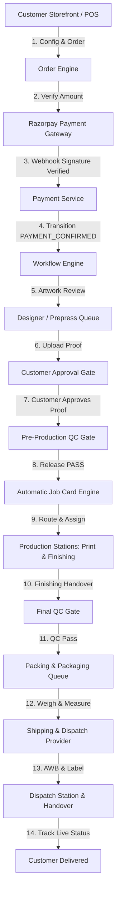

# PRINT BAZZAR 2.0 - Core System Architecture

## 1. System Vision & Paradigm
PRINT BAZZAR 2.0 is a unified Customer-to-Production Operating System built for print manufacturing, signage, custom branding, and corporate gifts. Unlike standard e-commerce carts, print manufacturing requires continuous customer-to-shop-floor coordination: artwork file preflighting, proof generation, approval sign-offs, production route resolution, physical work center scheduling, multi-stage QC inspections, multi-parcel packaging, and automated courier integration.

## 2. Core Architectural Tenets
1. **Single Source of Truth**:
   The `Order` entity forms the root aggregate. All child concepts (`OrderItem`, `ArtworkVersion`, `JobCard`, `QCChecklist`, `Package`, `Shipment`, `Invoice`) reference the master `Order` and maintain strict referential integrity.
2. **Deterministic State Machine**:
   Transitions across the 16 order workflow stages are validated by `OrderWorkflowService`. No frontend or controller can mutate order states arbitrarily. Transitions verify current state, required user department, role permissions, gate preconditions (e.g. proof approval or QC pass), and commit an immutable `AuditLog` entry atomically.
3. **Decoupled Asynchronous Workers**:
   Time-consuming workloads (document generation, email/SMS/WhatsApp notifications, courier API sync, SLA breach polling) are dispatched via Redis and BullMQ queues, keeping API response latency under 50ms.
4. **Resilient Offline / Walk-in Operations**:
   Walk-in store orders, B2B corporate purchase orders, and sales quotation conversions pass through the identical unified Order Engine and master workflow, preventing disparate shadow databases.
