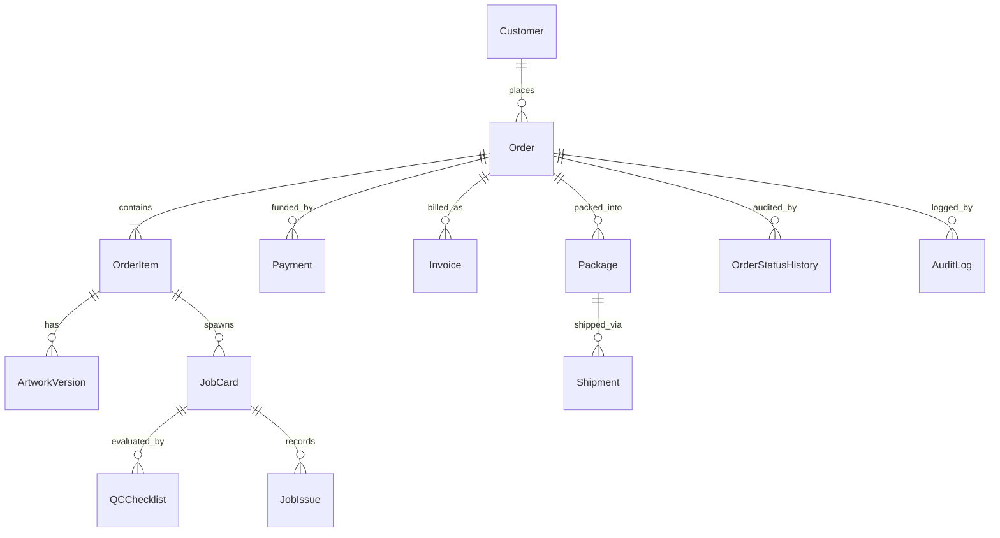

# Database Architecture & Entity-Relationship Model

## 1. Database Principles
- **Engine**: PostgreSQL 15+
- **ORM**: Prisma ORM with strict TypeScript model generation
- **Integrity**: Full foreign key relationships, strict cascades/restrict constraints, unique constraints on keys, idempotency locks.
- **Master Record Principle**: All operations anchor to `Order` (`orderNumber`) and `JobCard` (`jobNumber`).

---

## 2. Core Entities

### Entity Catalog
1. **User**: Authentication, RBAC role, department assignment, active status.
2. **Customer**: Customer profile, company, GSTIN, phone, addresses (billing & shipping).
3. **Address**: Normalized address entity (street, city, state, postalCode, country, contactName, phone).
4. **ProductCategory**: Category hierarchy (Paper Products, Apparel, Signage, Corporate Gifts, Packaging).
5. **Product**: Catalog item with pricing model (MATRIX, FORMULA, TIERED, FLAT), minimum quantity, production routes.
6. **ProductOption & ProductOptionValue**: Customizable attributes (Size, Material, GSM, Lamination, Print Side, Cut Type).
7. **PricingMatrix**: Tabular pricing rules (quantity range x attribute combinations).
8. **Order**: Master order aggregate (orderNumber, status, customerStatus, totalAmount, paidAmount, balanceAmount, paymentStatus, sourceChannel, priority, dueAt).
9. **OrderItem**: Line item snapshotting product config, chosen options, unit price, total price, production notes.
10. **ArtworkVersion**: Immutable artwork version (v1, v2...), file URL, preflight status, preview thumbnail, isApproved.
11. **JobCard**: Shop floor job card (jobNumber, orderId, orderItemId, approvedArtworkVersionId, currentStage, machineId, operatorId, priority, SLA dates).
12. **MachineWorkCenter**: Production machinery (e.g. Heidelberg 4-Color, HP Indigo 12000, Roland Wide-Format, Polar Cutting Guillotine, Lamination Unit).
13. **QCChecklist**: Pre-production or Final QC checklist with itemized checks (PASS/FAIL/NA), inspector sign-off, defect classification.
14. **JobIssue**: Structured production pause/hold reasons (artwork error, paper shortage, machine breakdown, customer revision).
15. **Package**: Physical carton/parcel (packageNumber, 1 of N, grossWeightGrams, dimensions, labelUrl, barcode).
16. **Shipment**: Courier integration record (courierName, awbNumber, trackingUrl, status, dispatchDate, deliveredDate).
17. **Payment**: Financial transaction record (transactionId, razorpayOrderId, razorpayPaymentId, method, status, amount, signatureVerified).
18. **Invoice**: Legal tax invoice (invoiceNumber, gstin, subtotal, taxBreakup, grandTotal).
19. **OrderStatusHistory**: Sequential log of order state transitions with duration and actor.
20. **AuditLog**: Immutable audit trail of sensitive mutations, user overrides, and system jobs.
